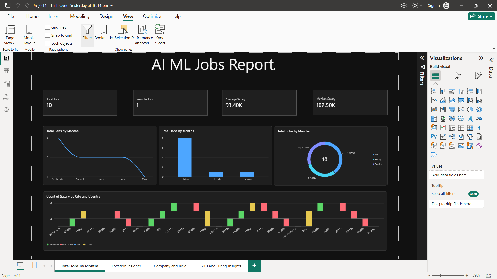
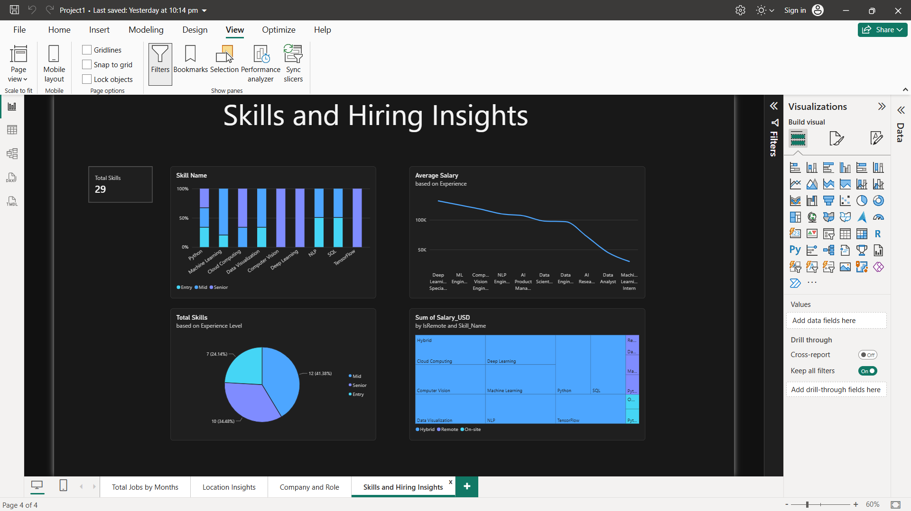
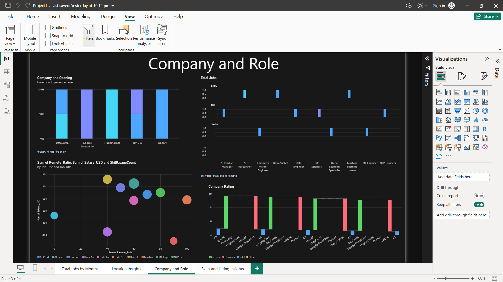
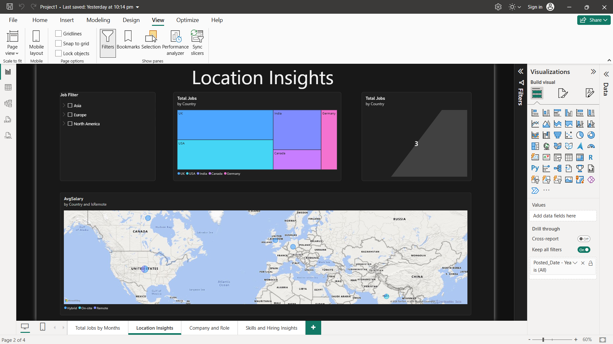

# AI/ML Jobs Market Report (Power BI)

A four-page interactive Power BI dashboard that analyzes the AI/ML job market: hiring trends, salaries by experience, in-demand skills, top companies, and job locations.

## Business Problem
People entering AI/ML need to know where the jobs are, what skills to learn, and what to expect to earn. This project is a scenario built around a public jobs dataset to answer those questions in one place.

## Goal of the Dashboard
Give job seekers a single view of the market:
- **Hiring trends:** how many roles are posted, when, and how many are remote
- **Skills:** which skills appear most and how they relate to pay
- **Companies and roles:** who hires, what titles pay, and how companies are rated
- **Locations:** which countries and cities have the most openings and the highest pay

## Dashboard Pages
**1. Total Jobs by Months**
KPI cards (Total Jobs, Average Salary, Median Salary, Remote Jobs), a monthly posting trend, job split by experience level, remote vs. on-site by experience, and salary by location.

**2. Skills and Hiring Insights**
A skills treemap, skill mix by experience level, average salary by experience for each job title, and skill counts by experience level.

**3. Company and Role**
Average company rating, jobs per company by experience level, job titles by experience and remote status, and a scatter chart of salary vs. skill usage vs. remote ratio.

**4. Location Insights**
A treemap of jobs by country and city, a map of average salary by country with remote split, and slicers for experience level, region, and posting date.

## Key Insights
- **Python is the most in-demand skill**, so it's the safest first skill to learn.
- **The US has the most AI/ML openings**, making it the largest market in the data.
- **Senior roles earn about 115% more** than Entry roles on average, so experience pays off quickly in this field.
- **1% of postings are remote.**
- Hiring peaked in **September** and dipped in **May**.

## Tools and Techniques
- **Power BI Desktop** for report design and interactivity
- **Power Query** for cleaning and transforming the data
- **Data modelling** with a fact table and four dimension tables
- **DAX** measures: TotalJobs, AvgSalary, MedianSalary, RemoteJobsCount, SkillUsageCount, AvgSalaryByExperience, JobsPerCompany, CompanyAvgRating
- **Visuals:** KPI cards, line, donut, treemap, waterfall, scatter, stacked column, map, slicers

## Recommendations
- Beginners should prioritize Python, since it appears most often in postings.
- Because Senior roles pay far more than Entry roles, early-career applicants should focus on skill depth and projects that speed up growth.
- Applicants targeting the US market should prepare for the most competition but also the most openings.

## Repository Structure
- `Data/` source dataset
- `Screenshots/` dashboard images
- `Job Analysis Dashboard.pbix` Power BI file
- `README.md`

## How to Use
Download the `.pbix` file and open it in Power BI Desktop (free, Windows only). Use the slicers and click visuals to explore the data.

## Author
Pranjal Chauhan | [LinkedIn](http://www.linkedin.com/in/pranjal-chauhan-34a7b3252) | pranjalchauhantech@gmail.com
